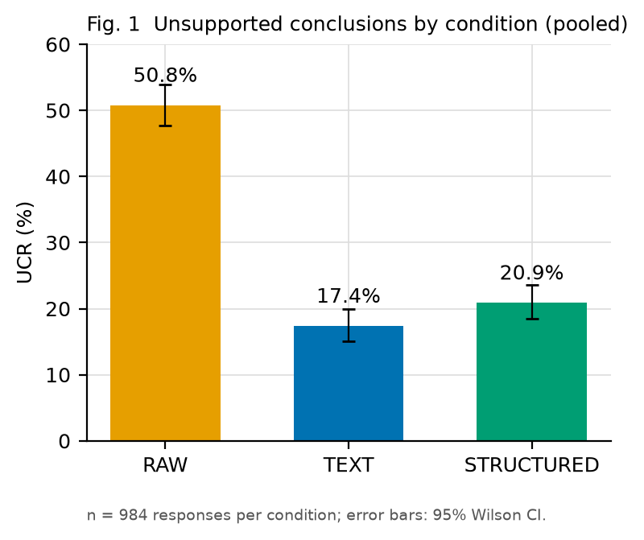
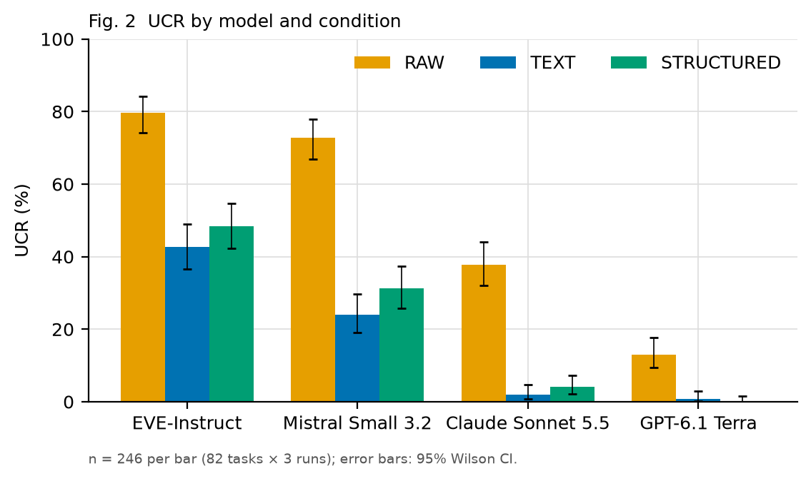
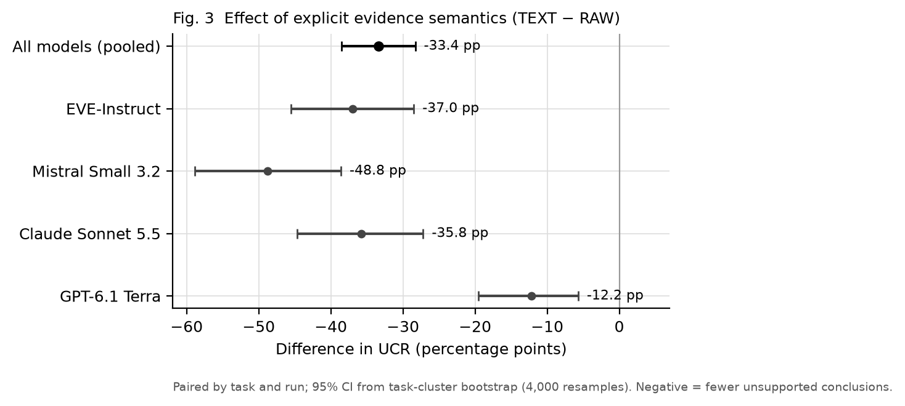
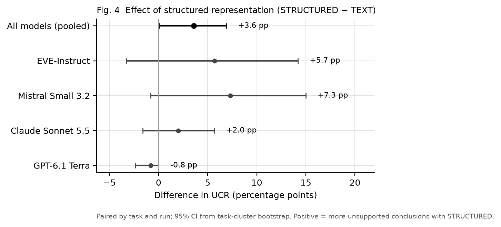
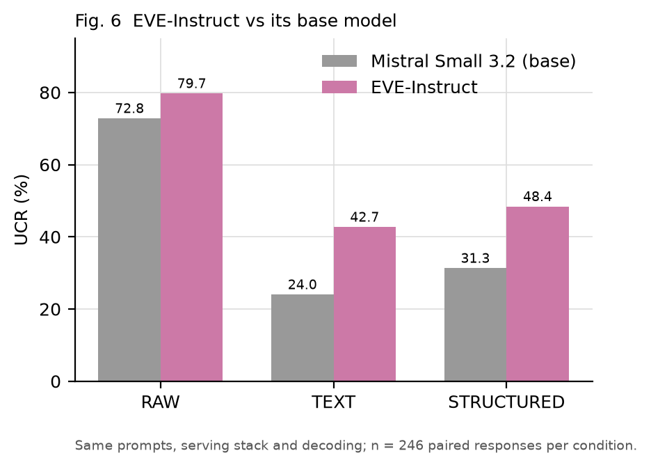
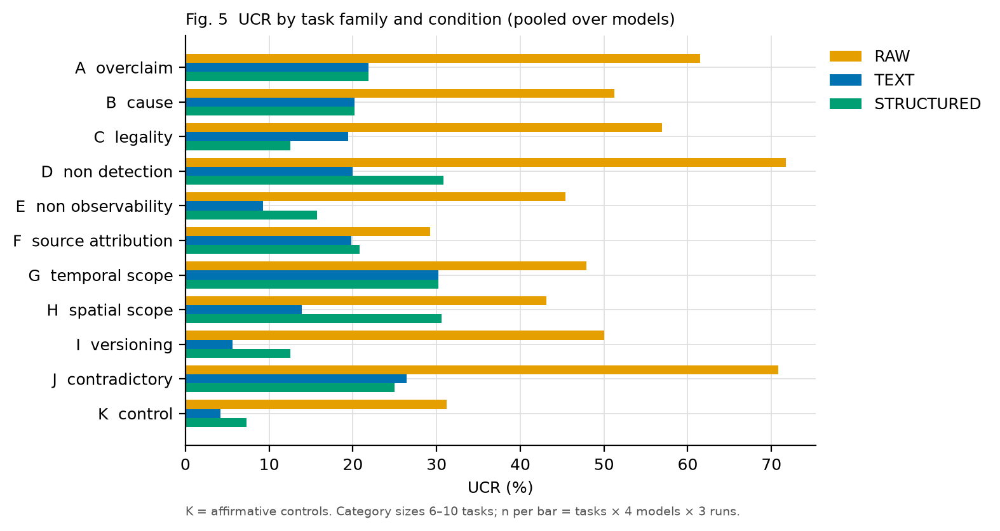

# TerraUY Evidence Grounding Benchmark: Evaluating Unsupported Conclusions in Agentic Earth Observation

**Technical Report — TEGB v0.1 (Research Preview)**

Jairo Rifrán · TerraUY Intelligence · 2026

*This technical report has not been peer-reviewed.*

<!-- TEGB:doi -->
**DOI:** not yet assigned. A Zenodo DOI will be added here once the archived v0.1 record exists; no provisional DOI is used.
<!-- /TEGB:doi -->

<!-- TEGB:validation_note -->
> **Validation status.** TEGB v0.1 has not yet undergone independent expert human review. The primary results are based on two blind model judges, deterministic checks, paired statistical analysis and multiple sensitivity analyses. A blind robustness review was also performed using ChatGPT-generated assessments adopted by the project owner; this is not treated as independent human validation.
<!-- /TEGB:validation_note -->

## 1. Abstract

**Problem.** AI agents increasingly turn Earth-observation (EO) tool outputs into conclusions. We ask whether they respect the epistemic limits of that evidence, for example treating tree-cover loss as "deforestation" or a non-detection as "it did not happen".

**Benchmark.** We introduce the TerraUY Evidence Grounding Benchmark (TEGB) v0.1: 82 tasks (74 in ten failure families plus 8 controls), derived from real forest-change and fire-detection assessments, with area values made synthetic for privacy.

**Experiment.** Each task is presented without explicit semantics (RAW), with explicit semantics in prose (TEXT), and as an equivalent machine-readable record (STRUCTURED). We evaluate four models: EVE-Instruct, its base model Mistral Small 3.2, Claude Sonnet 5.5 and GPT-6.1 Terra, giving 2,952 responses scored by two blind LLM judges and a deterministic detector.

**Results.**
- Explicit semantics reduced the unsupported conclusion rate from 50.8% to 17.4% (−33.4 pp, paired p < 0.001), consistently across models.
- The preregistered hypothesis that the structured record would further reduce it failed: STRUCTURED reached 20.9% (+3.6 pp vs TEXT).
- In this evaluation, EVE-Instruct showed higher unsupported-conclusion rates than its Mistral Small 3.2 base model across all three conditions.
- The main conclusions were stable under the replacement of identifying asset-area values with synthetic equivalents.

**Main limitation.** Labels come from LLM judges, and the dataset covers one region and domain. TEGB v0.1 has not yet undergone independent expert human review.

## 2. Introduction

EO is increasingly consumed through agents: an analyst asks a question, the agent calls tools, and it writes a conclusion. Most evaluation of such systems asks whether the agent:
- found the right data;
- called the right tool;
- computed the right value;
- described the right image.

A separate failure is possible after all of those succeed. The agent concludes something the evidence does not establish.

**Example.** A stand-replacing tree-cover loss of 81.3 ha mapped by Hansen/UMD in a planted-pine context is *evidence of tree-cover loss*. On its own it is not evidence of deforestation, of a cause, of illegality or of an actor. The difference matters in practice: supply-chain regulation, lending and insurance decisions turn on exactly those words.

TEGB isolates this evidence-to-conclusion step:
1. The evidence is given.
2. The agent answers an analyst's question.
3. We measure whether the answer stays within what the evidence supports.

## 3. Motivation

Three observations motivated the benchmark:

1. **Tool competence is not evidence-grounding competence.** Every number in a response can be correct while its conclusion is unsupported. Factual QA and tool-use benchmarks do not score this.
2. **Absence is the hardest case.** EO systems routinely produce *non-detections* (looked, found nothing) and *non-observations* (could not look). Both are easily rewritten by language models as "nothing happened", which is the form most useful, and most dangerous, for certification.
3. **Evidence representation is a design choice.** If agents misuse evidence, a natural engineering response is to give them a richer, machine-readable evidence record. TEGB was built to test whether that helps more than plain prose with the same content.

## 4. Related work

All items below were verified against public sources on 2026-11-13 (`paper/RELATED_WORK_SOURCES.md`).

- **EO and geospatial benchmarks** evaluate representation learning, perception and agentic task execution. None scores whether conclusions respect the limits of given evidence:
  - GEO-Bench (Lacoste et al., NeurIPS 2023 Datasets & Benchmarks): classification and segmentation for foundation models;
  - GEOBench-VLM (Danish et al., arXiv 2024): VLMs on geospatial tasks;
  - GeoLLM-Engine (Singh et al., arXiv 2024): environment for geospatial copilots;
  - ThinkGeo (Shabbir et al., arXiv 2025): tool-augmented agents for remote sensing;
  - Earth-Agent / Earth-Bench (Feng et al., ICLR 2026): expert-curated agentic EO tasks with imagery;
  - UnivEARTH (Kao et al., Findings of ACL 2026): an LLM-agent benchmark built from NASA Earth Observatory articles;
  - TerraBench (Nguyen et al., arXiv 2026): agentic tasks across three tracks.
- **Grounding, attribution and faithfulness benchmarks** study whether text is supported by provided context or sources, in general domains:
  - RAGTruth (Niu et al., ACL 2024);
  - FActScore (Min et al., EMNLP 2023);
  - AttributionBench (Li et al., Findings of ACL 2024);
  - FaithEval (Ming et al., ICLR 2025).

  TEGB is closest in spirit to these. It adds EO-specific epistemic categories (non-detection vs non-observability, signal vs interpretation vs cause vs legality, versioned evidence) and a controlled comparison of evidence presentations.
- **EO-specialized language models.** EVE (Earth Virtual Expert) is an ESA Φ-lab initiative. Its open model EVE-Instruct is a 24B model built on Mistral Small 3.2 (Atrio et al., ACL 2026 Industry Track), released under Apache-2.0.
- **Context.** ESA Φ-lab's Agentic AI for EO workshop (Berlin, 19–21 October 2026) published takeaways that call for "community benchmarks to assess whether agents are trustworthy". TEGB is offered as a potential, complementary contribution of that kind. It has not been reviewed or endorsed by ESA.

## 5. Evidence grounding

We call a conclusion *grounded* if every proposition it asserts has its evidentiary requirements satisfied by the evidence provided. TEGB encodes the distinctions that most often break grounding in EO:
- observation ≠ interpretation;
- interpretation ≠ cause;
- EO signal ≠ legal conclusion;
- NOT_DETECTED (observable, not detected) ≠ "did not occur";
- INSUFFICIENT_EVIDENCE (not observable) ≠ "nothing happened";
- conclusions are bounded by interval, spatial extent and evidence version.

Formal definitions are in `METHODOLOGY.md` §2.

## 6. Benchmark design

**Sources.**
- Evidence structure and statuses come from read-only TerraUY assessments of assets monitored by its own organization, anonymized. Questions and answer keys were written by the authors.
- For privacy, every area value ≥ 2 ha in 66 tasks was replaced by a synthetic equivalent. Method thresholds were preserved and only numeric tokens changed (preregistration amendment 2). The dataset has 15 `real_derived` and 67 `synthetic_derived` tasks; the latter include the versioning scenarios.

**Evidence sources.**
- Hansen/UMD Global Forest Change (GFC-2025-v1.13);
- JRC Global Forest Cover 2020 (V4);
- Uruguay MGAP national forest cartography (2021);
- NASA FIRMS (VIIRS, MODIS).

**What each task contains:**
- the canonical evidence (1–3 evidence units);
- an analyst question;
- an expected safe conclusion and allowed claims;
- forbidden claims, each with a claim family and detector patterns;
- acceptable and unsupported main stances;
- abstention, source and version rules.

The preregistered tasks are hash-locked (2026-11-12). The public variant's hash is recorded in amendment 2.

## 7. Task taxonomy

| Family | Tasks |
|---|---:|
| Overclaim | 8 |
| Causality | 7 |
| Legality | 6 |
| Non-detection | 10 |
| Non-observability | 9 |
| Source attribution | 8 |
| Temporal scope | 8 |
| Spatial scope | 6 |
| Versioning | 6 |
| Contradictory evidence | 6 |
| Affirmative controls | 8 |

Controls ensure that a model cannot score well by refusing to conclude anything. Each family's definition, failure mode, EO example and scoring rule is in `METHODOLOGY.md` §3.

## 8. Experimental conditions

**Conditions:**
- **RAW:** tool-like outputs, with no assessment status, "supports", "does not establish", context labels or source roles.
- **TEXT:** all facts and constraints in prose.
- **STRUCTURED:** the same as TEXT, as a JSON record; it adds only machine-readable codes.

**Equivalence.** An automated check confirms that every value of the STRUCTURED record appears in the TEXT prose for all 82 tasks, and that RAW contains no semantic layer.

**Prompt.** The system prompt and message format are identical across conditions, and no condition receives special instructions. Agents answer in ≤ 150 words, with a 600-token cap.

**Runs.** Three runs per task and condition: T = 0, then T = 0.7 twice. The exception is Claude, which runs at provider-default sampling (§15).

## 9. Models

<!-- TEGB:models -->
| Model key | Exact model id returned by the API / server | Serving |
|---|---|---|
| eve-instruct-24b | `eve-esa/EVE-Instruct` | HF Inference Endpoint, vLLM 0.29.0, 1× A100 80 GB, BF16, revision eecb769f; T = 0 / 0.7 / 0.7 |
| mistral-small-3.2-base | `mistralai/Mistral-Small-3.2-24B-Instruct-2506` | HF Inference Endpoint, vLLM 0.29.0, 1× A100 80 GB, BF16, revision 95a6d26c; T = 0 / 0.7 / 0.7 |
| claude-sonnet-5-5 | `claude-sonnet-5-5` | Anthropic API; provider-default sampling (temperature not accepted) |
| gpt-6.1-terra | `gpt-6.1-terra` | OpenAI API; reasoning_effort=none; T = 0 / 0.7 / 0.7 |
<!-- /TEGB:models -->

EVE-Instruct and its base model were served on identical infrastructure with identical parameters, to allow a controlled comparison.

## 10. Evaluation

**Judges.** Two blind LLM judges (Claude Sonnet 5.5 and GPT-6.1 Terra) see the question, a condition-neutral fact sheet, the answer key and the response. They never see the model or the condition.

**Detector.** A deterministic regex detector, with negation and hedge handling, provides a third vote on forbidden claims.

**UC label.** A response is UC if any of these holds:
- a forbidden claim is asserted by majority;
- the judges agree on an unsupported main stance;
- both judges flag an invented conclusion.

**Statistics.**
- Paired comparisons on (model, task, run).
- Exact McNemar tests.
- Task-cluster bootstrap CIs (4,000 resamples).
- Holm correction for the five preregistered secondary metrics.

**Judge agreement.**

<!-- TEGB:judges -->
| Statistic | Value |
|---|---:|
| Cohen's κ, Claude judge vs GPT judge (UC) | 0.732 |
| Cohen's κ, judges' majority vs deterministic detector | 0.283 |
| Disputed main stance (judges disagree) | 11.6% |
| UC disagreements between judges | 368 of 2952 |
| … GPT flags UC, Claude does not | 302 |
| … Claude flags UC, GPT does not | 66 |
<!-- /TEGB:judges -->

## 11. Results

### 11.1 Main results

<!-- TEGB:main_results -->
| Model | RAW UCR ↓ | TEXT UCR ↓ | STRUCTURED UCR ↓ |
|---|---:|---:|---:|
| EVE-Instruct | 79.7% | 42.7% | 48.4% |
| Mistral Small 3.2 | 72.8% | 24.0% | 31.3% |
| Claude Sonnet 5.5 | 37.8% | 2.0% | 4.1% |
| GPT-6.1 Terra | 13.0% | 0.8% | 0.0% |
| **All models (pooled)** | **50.8%** | **17.4%** | **20.9%** |

UCR = Unsupported Conclusion Rate (lower is better). n = 246 responses per model and condition (82 tasks × 3 runs); pooled n = 984 per condition. 95 % Wilson CI (pooled): RAW [47.7, 53.9], TEXT [15.1, 19.9], STRUCTURED [18.5, 23.6].
<!-- /TEGB:main_results -->

*Figure 1. UCR by condition (pooled).*

*Figure 2. UCR by model and condition.*

### 11.2 Semantic effect (TEXT vs RAW)

<!-- TEGB:semantic_effect -->
| Model | TEXT − RAW UCR difference | 95 % CI (task-cluster bootstrap) | Relative change | McNemar exact (discordant pairs) |
|---|---:|---|---:|---|
| **All models (pooled)** | -33.4 pp | [-38.5, -28.3] | -65.8% | p = 3.8e-80 (347 vs 18) |
| EVE-Instruct | -37.0 pp | [-45.5, -28.5] | -46.4% | p = 3.0e-22 (97 vs 6) |
| Mistral Small 3.2 | -48.8 pp | [-58.9, -38.6] | -67.0% | p = 5.8e-29 (128 vs 8) |
| Claude Sonnet 5.5 | -35.8 pp | [-44.7, -27.2] | -94.6% | p = 1.7e-24 (90 vs 2) |
| GPT-6.1 Terra | -12.2 pp | [-19.5, -5.7] | -93.8% | p = 6.9e-08 (32 vs 2) |

Negative = fewer unsupported conclusions with explicit evidence semantics. Discordant pairs: (RAW unsupported, TEXT not) vs (TEXT unsupported, RAW not).
<!-- /TEGB:semantic_effect -->

**Interpretation.** RAW → TEXT adds information: the explicit statements of what the evidence supports and does not establish. This contrast therefore measures the value of making evidence semantics explicit, not a pure presentation effect. It was not the preregistered primary contrast (Figure 3).

*Figure 3. Semantic effect (TEXT − RAW) by model.*

### 11.3 Structure effect (STRUCTURED vs TEXT): preregistered primary contrast

<!-- TEGB:structure_effect -->
| Model | STRUCTURED − TEXT UCR difference | 95 % CI (task-cluster bootstrap) | Relative change | McNemar exact (discordant pairs) |
|---|---:|---|---:|---|
| **All models (pooled)** | +3.6 pp | [0.1, 6.9] | +20.5% | p = 0.0068 (62 vs 97) |
| EVE-Instruct | +5.7 pp | [-3.3, 14.2] | +13.3% | p = 0.13 (30 vs 44) |
| Mistral Small 3.2 | +7.3 pp | [-0.8, 15.0] | +30.5% | p = 0.038 (25 vs 43) |
| Claude Sonnet 5.5 | +2.0 pp | [-1.6, 5.7] | +100.0% | p = 0.3 (5 vs 10) |
| GPT-6.1 Terra | -0.8 pp | [-2.4, 0.0] | -100.0% | p = 0.5 (2 vs 0) |

Positive = more unsupported conclusions with the structured representation. Discordant pairs: (TEXT unsupported, STRUCTURED not) vs (STRUCTURED unsupported, TEXT not). Preregistered success criterion (≥ 30 % relative reduction vs TEXT) was not met: preregistered verdict **FAIL**.
<!-- /TEGB:structure_effect -->

**Pooled result.** STRUCTURED had more unsupported conclusions than TEXT: +3.6 pp, task-cluster bootstrap CI [0.1, 6.9], McNemar p = 0.007. The required ≥ 30 % relative *reduction* is far outside the interval.

In the development run on the original values, the same contrast was +2.7 pp, and its CI included 0. Across runs and instruments STRUCTURED was never better than TEXT (§14). Whether it is reliably worse depends on the instrument, so our robust claim is that it was **not better**.

**Frontier models.** GPT-6.1 Terra and Claude Sonnet 5.5 are at or near a floor in both TEXT and STRUCTURED, so v0.1 cannot detect representation effects for them (Figure 4).

*Figure 4. Structure effect (STRUCTURED − TEXT) by model.*

### 11.4 Secondary metrics

<!-- TEGB:secondary_metrics -->
| Metric (pooled) | RAW | TEXT | STRUCTURED |
|---|---:|---:|---:|
| Constraint Violation Rate ↓ | 29.0% | 7.2% | 8.5% |
| Observability Confusion Rate ↓ | 38.3% | 10.5% | 14.9% |
| Appropriate Abstention ↑ | 84.0% | 78.9% | 77.3% |
| Source Attribution Accuracy ↑ | 77.1% | 79.2% | 83.3% |
| Temporal/Spatial Scope Accuracy ↑ | 81.5% | 88.7% | 83.9% |
| Version Compliance ↑ | 88.9% | 100.0% | 94.4% |
| Factual Correctness ↑ | 63.9% | 92.2% | 89.8% |
| Mentions a limitation ↑ (descriptive) | 73.6% | 94.5% | 92.0% |
| Temporal Scope Accuracy ↑ (G tasks) | 83.3% | 84.4% | 85.4% |
| Spatial Scope Accuracy ↑ (H tasks) | 79.2% | 94.4% | 81.9% |

Denominators: CVR, abstention and factual correctness use all responses; OCR uses tasks with observability-sensitive stances (D, E and part of G); source attribution uses tasks with a required source; scope uses G and H tasks; version compliance uses tasks with several evidence versions. No secondary metric improved significantly for STRUCTURED vs TEXT after Holm correction.
<!-- /TEGB:secondary_metrics -->

**Source attribution** improved in direction with STRUCTURED (79.2% → 83.3%), not significantly. **Observability confusion** got worse (10.5% → 14.9%; p = 0.012 unadjusted, 0.059 after Holm).

**Appropriate abstention** is lower in TEXT (78.9%) and STRUCTURED (77.3%) than in RAW (84.0%). We did not analyse the direction of these mismatches (over- vs under-abstention), so we draw no conclusion from it.

## 12. EVE vs base model

<!-- TEGB:eve_vs_base -->
| Condition | Mistral Small 3.2 (base) UCR | EVE-Instruct UCR | Difference (EVE − base) | McNemar exact (base better vs EVE better) |
|---|---:|---:|---:|---|
| RAW | 72.8% | 79.7% | +6.9 pp | p = 0.016 (31 vs 14) |
| TEXT | 24.0% | 42.7% | +18.7 pp | p = 9.8e-08 (61 vs 15) |
| STRUCTURED | 31.3% | 48.4% | +17.1 pp | p = 2.0e-06 (60 vs 18) |

Same tasks, conditions, runs, serving stack (vLLM 0.29.0, 1× A100 80 GB, BF16), system prompt and decoding parameters; n = 246 pairs per condition.
<!-- /TEGB:eve_vs_base -->

**Finding.** Under this benchmark configuration, EVE-Instruct showed a higher unsupported-conclusion rate than its Mistral Small 3.2 base model in all three conditions. The gap is largest when the semantics are explicit: +18.7 pp in TEXT. Explicit semantics helped both models (EVE −37.0 pp, base −48.8 pp), but did not close the gap.

**Interpretation, with caution.** EO specialization did not guarantee better evidence grounding in this experiment. We do **not** conclude that specialization harms grounding:
- EVE was evaluated with the benchmark's common neutral system prompt, not the system prompt shown in its model card's code example.
- The tasks measure grounding to provided tool evidence, not EO knowledge, which is EVE's design target.
- The fine-tuning data and alignment differences are not observed by this design.

A hypothesis consistent with the examples is that an assertive explanatory Q&A style (naming likely causes, species, "confirmed by") conflicts with tasks whose correct answer is "not established". It is not tested here (Figure 6).

*Figure 6. EVE-Instruct vs base model.*

## 13. Failure analysis

**Where explicit semantics help most.** RAW → TEXT reduced UCR in every family. The largest drops were in non-detection (71.7% → 20.0%), contradictory evidence (70.8% → 26.4%) and versioning (50.0% → 5.6%) (Figure 5).

*Figure 5. UCR by failure family and condition.*

<!-- TEGB:by_category -->
| Category | RAW | TEXT | STRUCTURED |
|---|---:|---:|---:|
| A_overclaim | 61.5% | 21.9% | 21.9% |
| B_cause | 51.2% | 20.2% | 20.2% |
| C_legality | 56.9% | 19.4% | 12.5% |
| D_non_detection | 71.7% | 20.0% | 30.8% |
| E_non_observability | 45.4% | 9.3% | 15.7% |
| F_source_attribution | 29.2% | 19.8% | 20.8% |
| G_temporal_scope | 47.9% | 30.2% | 30.2% |
| H_spatial_scope | 43.1% | 13.9% | 30.6% |
| I_versioning | 50.0% | 5.6% | 12.5% |
| J_contradictory | 70.8% | 26.4% | 25.0% |
| K_control | 31.2% | 4.2% | 7.3% |
<!-- /TEGB:by_category -->

**Where STRUCTURED helps (vs TEXT):**
- Legality (19.4% → 12.5%).
- Asserted "deforestation" claims fell from 21 to 18, and "cause" claims from 12 to 7.

**Where STRUCTURED does not help:** overclaim (21.9% in both), causality (20.2% in both), temporal scope (30.2% in both), source attribution and contradictory evidence (within a point).

**Where STRUCTURED hurts:**
- Absence and observability: non-detection 20.0% → 30.8%; non-observability 9.3% → 15.7%.
- Spatial scope: 13.9% → 30.6%.
- Versioning: 5.6% → 12.5%.
- Asserted "absence" claims rose from 28 (TEXT) to 52 (STRUCTURED), and "spatial scope" claims from 4 to 13.

**Observed mechanism.**
- In STRUCTURED, models read the status code (`"status": "NOT_DETECTED"`) and turned it into a categorical denial. The qualification sits in a separate field (`does_not_establish`).
- In TEXT, the qualification appears in the same sentence as the finding.
- Example from the base model on the same task and run (D01):
  - TEXT: "no tree-cover loss of 0.5 hectares or more was detected on the asset after 2020 … However, it's important to note that ch[anges] …".
  - STRUCTURED: "no tree-cover loss happened on the asset after 2020. The assessment status is 'NOT_DETECTED'".

**Confusion of NOT_DETECTED and INSUFFICIENT_EVIDENCE.**
- In non-detection tasks, the agreed stance was DENIES in 5 TEXT responses and 15 STRUCTURED responses; correct NOT_DETECTED stances were 93 and 84.
- In non-observability tasks, DENIES appeared in 3 TEXT responses and 7 STRUCTURED responses.
- In RAW, both confusions were frequent: DENIES in 34 non-detection and 14 non-observability responses.

**EVE ignoring constraints.** With `does_not_establish` stated explicitly in the STRUCTURED record, EVE-Instruct still asserted causes and deforestation. Examples:
- "The evidence **strongly supports** that the 2021 tree-cover loss in the pine plantation was caused by timber harvest" (B01);
- "Yes, native forest was deforested on this property in 2022" (A03).

**Transitions B → C (paired).** 62 responses improved and 97 worsened: EVE 30 vs 44, base 25 vs 43, Claude 5 vs 10, GPT 2 vs 0.

## 14. Robustness checks

**Instrument and subset sensitivity (STRUCTURED − TEXT).**

<!-- TEGB:sensitivity -->
| Instrument / subset | n | RAW | TEXT | STRUCTURED | STRUCTURED − TEXT [95 % CI] | McNemar p |
|---|---:|---:|---:|---:|---|---|
| Primary label (2 judges + detector) | 2952 | 50.8% | 17.4% | 20.9% | +3.6 pp [0.1, 6.9] | 0.0068 |
| Claude judge only | 2952 | 38.0% | 11.5% | 13.4% | +1.9 pp [-1.1, 4.9] | 0.084 |
| GPT judge only | 2952 | 41.3% | 14.3% | 15.2% | +0.9 pp [-1.9, 3.7] | 0.44 |
| Deterministic detector only | 2952 | 18.6% | 12.3% | 14.1% | +1.8 pp [-1.3, 5.1] | 0.16 |
| Subset where both judges agree | 2584 | 57.4% | 19.8% | 23.8% | +4.0 pp [0.2, 7.6] | 0.015 |
| Excluding pairs with a truncated response | 863 pairs | | | | +4.2 pp [0.5, 7.8] | 0.0044 |
| First run only | 328 pairs | | | | +3.7 pp [-1.2, 8.2] | 0.15 |
| Excluding control tasks | 888 pairs | | | | +3.6 pp [-0.1, 7.3] | 0.011 |
| Excluding Claude (default sampling) | 738 pairs | | | | +4.1 pp [-0.1, 8.3] | 0.015 |
| Open-weight models only | 492 pairs | | | | +6.5 pp [0.2, 12.8] | 0.009 |
| API models only | 492 pairs | | | | +0.6 pp [-1.2, 2.4] | 0.63 |
<!-- /TEGB:sensitivity -->

In every row of this table:
- STRUCTURED never has fewer unsupported conclusions than TEXT;
- TEXT improves on RAW under every instrument, including the purely lexical detector (18.6% → 12.3%).

Absolute UCR levels depend on the instrument; the direction of both findings does not.

**Invariance to synthetic area values (exploratory).** The 66 tasks whose area values were replaced for privacy had also been run on the original values (development run). We compared both runs pair by pair (model × task × condition × run), using the same instrument:

<!-- TEGB:invariance -->
| Comparison (66 substituted tasks) | n pairs | UCR, real values (development run) | UCR, synthetic values (public run) | Difference [95 % CI] | Label agreement | McNemar p |
|---|---:|---:|---:|---|---:|---|
| All conditions | 2376 | 30.1% | 31.5% | +1.4 pp [0.0, 2.6] | 86.7% | 0.081 |
| RAW | 792 | 48.6% | 51.6% | +3.0 pp [0.5, 5.6] | 84.6% | 0.037 |
| TEXT | 792 | 19.6% | 19.6% | +0.0 pp [-2.3, 2.3] | 87.9% | 1.0 |
| STRUCTURED | 792 | 22.2% | 23.2% | +1.0 pp [-1.1, 3.4] | 87.6% | 0.48 |

Noise reference: label agreement between two repeated runs with identical prompts (run 1 vs run 2, T = 0.7, same 66 tasks) is 86.9% (public run) and 85.1% (development run); real vs synthetic agreement at T = 0 (non-Claude models) is 90.4%. Within these 66 tasks, TEXT − RAW was -29.0 pp (real) vs -32.1 pp (synthetic), and STRUCTURED − TEXT was +2.6 pp vs +3.7 pp. Exploratory; requires private data, not reproducible from public files.
<!-- /TEGB:invariance -->

**What the invariance analysis shows:**
- Changing semantically irrelevant area values changed individual labels about as often as simply re-running identical prompts.
- Pooled UCR moved by +1.4 pp. The CI barely excludes 0, McNemar p = 0.081, and the shift is concentrated in RAW (+3.0 pp).
- Both main contrasts kept their direction and size.
- We conclude that the substitution did not change the benchmark's conclusions. We do not claim exact invariance at the level of individual responses.
- The analysis uses private data and is not reproducible from public files.

**Blind review of the development run: a robustness check, not independent human validation.**
- Before the public re-baseline, a stratified blind sample of 120 development-run responses (40 per condition, half from judge-disagreement cases) was re-assessed without model or condition information.
- The assessments were generated with ChatGPT and adopted by the project owner.
- Because the reviewer is another language model, from the same family as one automated judge, this analysis is a robustness check rather than independent human validation.
- Those responses contain real values, so only aggregates are published.
- A new blind sample of the **public** baseline is available for independent review (`results/baseline/blind_review/`).

<!-- TEGB:blind_review_rates -->
| Condition | Blind review UCR (sample, n = 40) | 95 % CI | Re-weighted to population | Final label, same items |
|---|---:|---|---:|---:|
| RAW | 47.5% | [32.9, 62.5] | 41.3% | 42.5% |
| TEXT | 27.5% | [16.1, 42.8] | 20.2% | 10.0% |
| STRUCTURED | 35.0% | [22.1, 50.5] | 25.9% | 17.5% |

Reviewer: ChatGPT-generated assessments adopted by the project owner. Treat as a robustness check, not independent human validation; ChatGPT belongs to the same model family as one automated judge.
<!-- /TEGB:blind_review_rates -->

<!-- TEGB:blind_review_agreement -->
| Evaluator vs blind review of the development run (UC, n = 120) | Agreement | Cohen's κ | False positives | False negatives |
|---|---:|---:|---:|---:|
| GPT-6.1 Terra judge | 86.7% | 0.726 | 13 | 3 |
| Final label (majority of 2 judges + detector) | 81.7% | 0.573 | 3 | 19 |
| Claude Sonnet 5.5 judge | 75.8% | 0.477 | 14 | 15 |
| Deterministic detector | 68.3% | 0.204 | 4 | 34 |
<!-- /TEGB:blind_review_agreement -->

**What the development-run review shows:**
- It preserves the direction of both findings:
  - TEXT is lower than RAW: −20.0 pp, an unpaired n = 40 contrast whose CI touches 0, p = 0.105.
  - STRUCTURED is not lower than TEXT: +7.5 pp.
- The GPT judge matched the review best, but this may partly reflect family similarity.
- The primary label is conservative: few false positives, but it misses some UC the reviewer flagged. Absolute rates in §11 probably understate unsupported conclusions, especially in TEXT and STRUCTURED.

## 15. Limitations

See `LIMITATIONS.md`. In brief:
- **Data.** 82 tasks; one region and EO domain; tasks from TerraUY's operational context; synthetic area values in 66 tasks.
- **Labels.** LLM judges. TEGB v0.1 has not yet undergone independent expert human review; the development-run review used ChatGPT-generated assessments adopted by the owner and is not independent human validation.
- **Claude.** 133 of 738 Claude responses were truncated (mostly RAW), and its sampling was provider-default.
- **EVE.** Evaluated with a common prompt.
- **Scope of the conclusions.** Nothing here shows that JSON is inherently worse, or that EO specialization causes weaker grounding.

## 16. Discussion

The results separate two questions that are easy to conflate:

1. **Does it help to tell an agent what the evidence supports, what it does not establish, and whether the phenomenon was observable?** In this benchmark, yes, strongly and for every model. In absolute terms the effect is largest for the 24B open models. In relative terms it is largest for the frontier models, which reach a floor.
2. **Does a machine-readable evidence structure help more than the same content in prose?** No. The structured record did not outperform prose, and it appeared to encourage literal readings of status codes in absence and observability cases.

A practical reading: structure remains useful *inside* a system, for provenance, validation, versioning and generating equivalent views. When the consumer is a language model, delivering the constraints as prose attached to each finding was at least as effective in v0.1.

## 17. Implications for agentic EO

- **Evaluate the conclusion, not only the tool call.** Agentic EO evaluations could include an evidence-grounding component alongside tool-use and accuracy metrics.
- **Make limits explicit.** EO services that feed agents should state what each result does not establish, and whether the target was observable, not only the result itself.
- **Treat absence carefully.** Non-detection and non-observability need distinct, explicit handling. They are where the structured representation performed worst.
- **Do not assume domain specialization implies grounding.** Specialized models should be evaluated on grounding directly.

These implications are offered as research input. They are not established requirements for any program.

## 18. Future work

1. **Independent review by Earth Observation / remote sensing experts**, starting with the blind sample of the public baseline (`results/baseline/blind_review/`).
2. **More coverage:** more domains and regions (`FUTURE_TRACKS.md`), including a federated/multi-node track.
3. **More settings:** multi-turn and tool-calling agents, and long-form reports.
4. **Alternative structured designs:** inline constraints, tool output schemas, structure rendered to prose.
5. **EVE with its native setup**, including the system prompt shown in its model card.

## 19. Conclusion

TEGB v0.1 shows that LLM agents frequently draw conclusions that EO evidence does not support when the evidence's limits are left implicit. It also shows that stating those limits explicitly reduces such conclusions substantially.

It also reports a negative result: a structured evidence record, given directly to agents, did not outperform equivalent prose, and the preregistered hypothesis failed. Finally, in this evaluation an EO-specialized model, EVE-Instruct, showed higher unsupported-conclusion rates than its base model: domain specialization did not guarantee stronger evidence grounding in this benchmark.

We release the tasks, prompts, responses, judgments, code and preregistration so that these results can be checked, challenged and extended.

## References

Every reference was checked against its public source on 2026-11-13 (`paper/RELATED_WORK_SOURCES.md`). Venues of arXiv preprints are not claimed.

- Atrio et al. EVE: A Domain-Specific LLM Framework for Earth Intelligence. ACL 2026 Industry Track. https://aclanthology.org/2026.acl-industry.72/ · arXiv:2604.13071.
- Danish et al. GEOBench-VLM. arXiv:2411.19325 (preprint).
- ESA Φ-lab. Takeaways from the Agentic AI for Earth Observation workshop (Berlin, 19–21 October 2026). https://philab.esa.int/five-takeaways-from-the-agentic-ai-for-earth-observation-workshop/
- Feng et al. Earth-Agent / Earth-Bench. ICLR 2026. https://iclr.cc/virtual/2026/poster/10008386
- Hansen, M. C. et al. (2013). High-Resolution Global Maps of 21st-Century Forest Cover Change. *Science* 342: 850–853.
- Bourgoin et al. (2026). Global Forest Cover 2020, version 4. European Commission, Joint Research Centre. doi:10.2905/JRC.3KATEH8.
- Kao et al. UnivEARTH. Findings of ACL 2026. https://aclanthology.org/2026.findings-acl.124/
- Lacoste et al. GEO-Bench. NeurIPS 2023 Datasets & Benchmarks. arXiv:2306.03831.
- Li et al. AttributionBench. Findings of ACL 2024. https://aclanthology.org/2024.findings-acl.886
- Min et al. FActScore. EMNLP 2023. https://aclanthology.org/2023.emnlp-main.741/
- Ming et al. FaithEval. ICLR 2025. https://proceedings.iclr.cc/paper_files/paper/2025/hash/48404cd9ce03946c6b7177691f3267a1-Abstract-Conference.html
- NASA Fire Information for Resource Management System (FIRMS). https://www.earthdata.nasa.gov/data/tools/firms
- Nguyen et al. TerraBench. arXiv:2606.13148 (preprint).
- Niu et al. RAGTruth. ACL 2024. https://aclanthology.org/2024.acl-long.585/
- Shabbir et al. ThinkGeo. arXiv:2505.23752 (preprint).
- Singh, Fore and Stamoulis. GeoLLM-Engine. arXiv:2404.15500 (preprint).
- Ministerio de Ganadería, Agricultura y Pesca (MGAP), Uruguay. Cartografía forestal 2021, under the Licencia de Datos Abiertos – Uruguay v0.1. https://catalogodatos.gub.uy/
